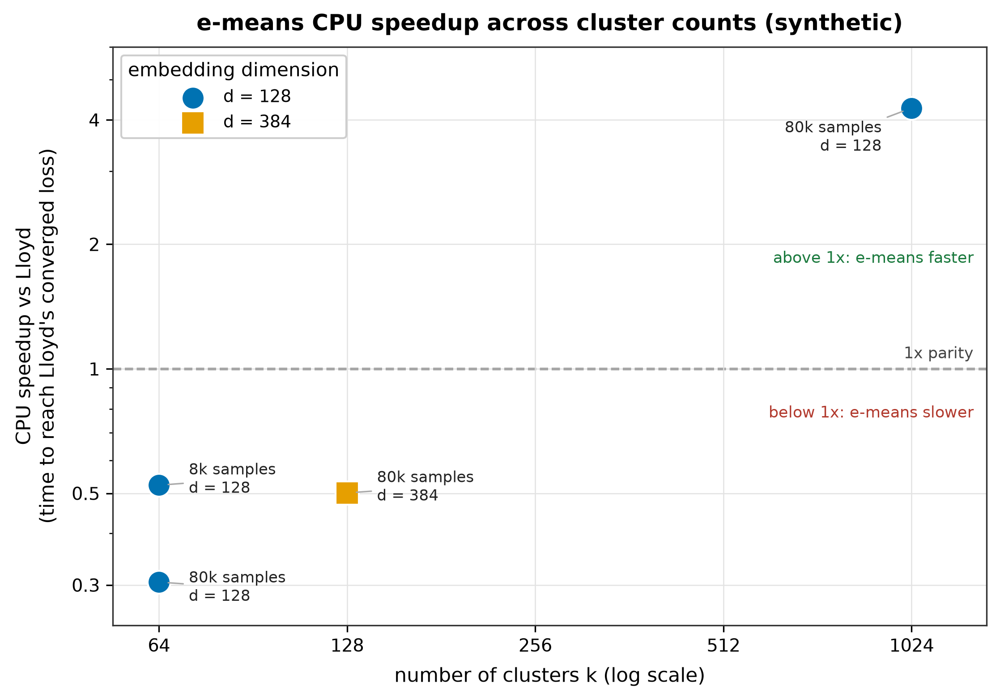
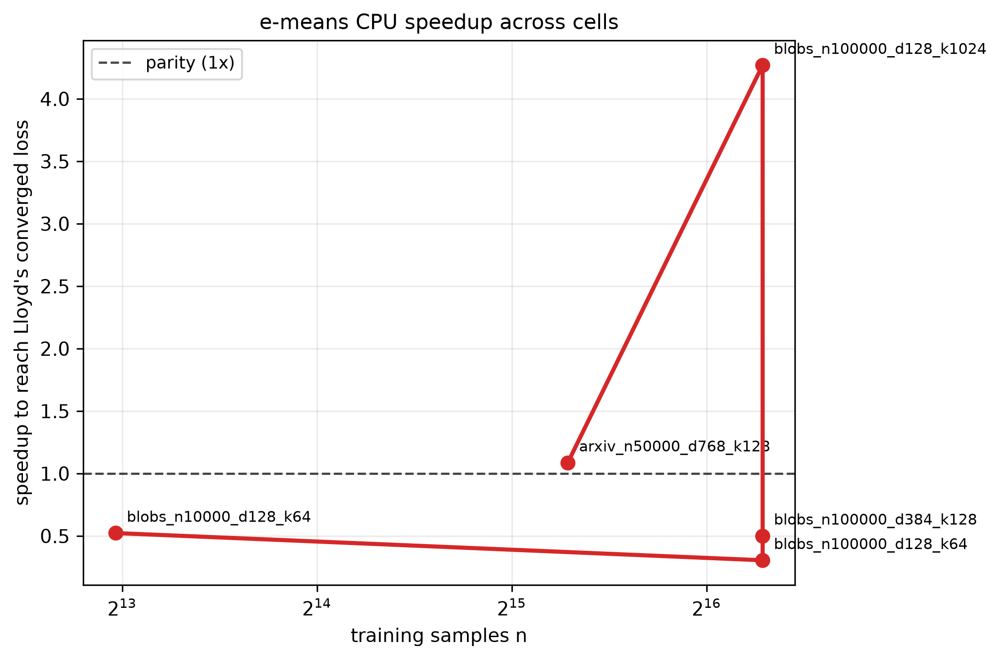
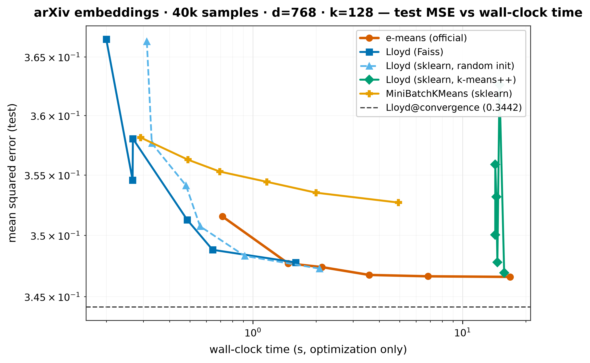

<div align="center">

# e-means on CPU

A reproducible benchmark of **e-means**, **Lloyd's k-means**, and **MiniBatchKMeans**

Official Faiss implementation · CPU-only experiments · Convergence, runtime, and ablations

[Paper](https://arxiv.org/abs/2611.09501) · [Official implementation](https://github.com/facebookresearch/faiss/tree/main/contrib/e_means) · [Research report](docs/research_report.md) · [Experiment notes](docs/paper_notes.md)

</div>

## Overview

e-means is a clustering algorithm that replaces Lloyd's full-dataset centroid
updates with mini-batch updates of exponentially weighted cluster counts and
vector sums. It also introduces scheduling and dead-cluster handling. This
repository evaluates whether its reported improvements in convergence quality
and data passes translate into wall-clock gains on an ordinary CPU.

This is a reproduction using the official `faiss.contrib.e_means.NumpyEmeans`
implementation, not a new e-means implementation. The comparisons and figures
here are from this repository's experiments; the original paper's GPU speedups
are not presented as locally reproduced results.

## Results at a glance

Headline: e-means reached the Lloyd reference objective in **1–2 epochs** across
the five reported configurations, but CPU wall-clock speedups ranged from
**0.31× to 4.27×**. Fewer epochs did not always imply less elapsed time.

| Finding | Observed result |
|---|---|
| Clustering quality | Lower reported final objective than Lloyd in all five tested configurations |
| Epochs to Lloyd reference loss | 1–2 e-means epochs in the reported grid |
| CPU time to reference loss | 0.31×–4.27× relative to Lloyd; below 1× means slower |
| Real embedding dataset | 1.09× at 40,000 vectors, 768 dimensions, 128 clusters |
| Ablations | Dead-cluster revival had the largest reported effect; the benefit of cosine scheduling was not consistently confirmed |

The above figures summarize the repository's existing experiment outputs. See
methodology and limitations before interpreting them as broadly generalizable
results.

### CPU speedup across cluster counts



Speedup is Lloyd's time divided by e-means time to reach Lloyd's converged
objective. The dashed line marks parity: values above 1 indicate e-means is
faster; values below 1 indicate it is slower.

### CPU speedup across benchmark configurations



Results depend on dataset size, dimensionality, and number of clusters. These
are local CPU measurements, not the GPU speedups reported by the paper.

### Convergence on real embeddings

The real-data experiment uses arXiv-title embeddings from the Qdrant arXiv
titles Instructor-XL dataset. The benchmark uses 40,000 vectors with 768
dimensions and 128 clusters.



Objective versus wall-clock time. The filename reflects the requested dataset
configuration (`n50000`); the published result table reports the evaluated
real-data sample as 40,000 vectors.

For the complementary epoch-based view, see
[MSE versus epochs](figures/arxiv_n50000_d768_k128_mse_vs_epochs.png). Additional
curves, runtime comparisons, and ablations are in [`figures/`](figures/).

## Benchmark results

The repository reports the following median times across three seeds, with CPU
threading restricted to four threads. The objective is the mean squared distance
to the nearest centroid. "Speedup" is defined as Lloyd time / e-means time to
Lloyd's reference objective; it is not an equal-epoch runtime comparison.

| Dataset | Vectors | Dimensions | Clusters | e-means objective | Lloyd objective | e-means epochs to target | e-means time | Lloyd time | Speedup |
|---|---|---|---|---|---|---|---|---|---|
| Synthetic blobs | 8,000 | 128 | 64 | **134.50** | 147.50 | 1 | 0.033 s | 0.017 s | 0.52× |
| Synthetic blobs | 80,000 | 128 | 64 | **142.18** | 145.14 | 1 | 0.220 s | 0.067 s | 0.31× |
| Synthetic blobs | 80,000 | 384 | 128 | **403.11** | 454.88 | 1 | 0.757 s | 0.379 s | 0.50× |
| Synthetic blobs | 80,000 | 128 | 1,024 | **134.26** | 145.12 | 2 | 0.814 s | 3.474 s | 4.27× |
| arXiv embeddings | 40,000 | 768 | 128 | **0.3432** | 0.3444 | 2 | 1.473 s | 1.602 s | 1.09× |

**Interpretation:** e-means was more effective by the reported objective in these
tested cases, but it was faster on the CPU only in some settings. In particular,
its advantage increased substantially for the synthetic configuration with 1,024
clusters. The data do not support a general claim that e-means is always faster
on CPU.

## How e-means works

For every cluster `j`, e-means maintains exponentially weighted estimates of its
assigned count `N_j` and vector sum `S_j`, then recovers the centroid as
`c_j = S_j / N_j`. Instead of waiting for a full pass over the dataset, it
updates these statistics after each mini-batch.

Conceptually, the algorithm combines:

1. Mini-batch assignments, allowing frequent centroid updates.
2. EMA statistics, blending new assignments with previously accumulated information.
3. A cosine step-size schedule, reducing update strength during training.
4. Dead-cluster revival, reassigning capacity to underused clusters.
5. Scaling laws, choosing batch size and update parameters from the task scale.

See [paper notes](docs/paper_notes.md) for the equations and the documented
differences between the paper and the packaged implementation.

## Reproduce the experiments

### Requirements

- Ubuntu or another compatible Linux system
- Python 3.13 and `uv`
- CPU-only installation of Faiss (`faiss-cpu >= 1.16.0`)
- Enough RAM for the selected benchmark sizes and the real embedding dataset

The reported machine was an Intel Core i7-1185G7 (4 physical / 8 logical cores),
30 GiB RAM, Ubuntu 24.04, Python 3.13, `faiss-cpu 1.16.0`, using four
OpenMP/BLAS threads. No GPU was used.

```bash
uv venv --python 3.13 .venv
uv pip install --python .venv/bin/python -r requirements.txt
export OMP_NUM_THREADS=4
.venv/bin/python -m pytest -q
```

### Run one benchmark

```bash
OMP_NUM_THREADS=4 .venv/bin/python scripts/run_benchmark.py \
  --dataset blobs --n 10000 --d 128 --k 64 \
  --seeds 0 1 2 --budgets 1 2 3 5 10 25
```

### Run the full experiment suite

```bash
# Main benchmark grid
.venv/bin/python scripts/run_grid.py configs/benchmark_grid.json

# Component ablations
.venv/bin/python scripts/run_grid.py configs/ablations.json

# Cosine-schedule controls, with retuned constant-step comparisons
.venv/bin/python scripts/run_cosine_ablation.py \
  --dataset arxiv --n 50000 --d 768 --k 128 --epochs 5
.venv/bin/python scripts/run_cosine_ablation.py \
  --dataset blobs --n 100000 --d 128 --k 1024 --epochs 5

# Regenerate figures and summary tables
.venv/bin/python scripts/make_figures.py \
  blobs_n10000_d128_k64 blobs_n100000_d128_k64 \
  blobs_n100000_d384_k128 blobs_n100000_d128_k1024 \
  arxiv_n50000_d768_k128
.venv/bin/python scripts/make_scaling_figure.py
```

The real-data run downloads the public embedding dataset on first use. Benchmark
scripts may produce fewer usable vectors than a requested count, as reflected in
the reported result table.

## Benchmark methodology

- **Same metric:** nearest-centroid squared Euclidean distance, evaluated through
  a shared Faiss-based routine.
- **Controlled initialization:** the methods use matching sampled initial
  centroids where supported; the k-means++ baseline uses its own initialization.
- **Optimized baseline:** the Lloyd comparison uses Faiss/scikit-learn native
  code, rather than deliberately slow pointwise Python loops.
- **Measurement:** `time.perf_counter` tracks optimization time; dataset
  generation and initialization are recorded separately.
- **Comparable target:** a time-to-target calculation asks how long each method
  needs to meet the Lloyd reference objective, avoiding a misleading comparison
  based solely on epoch count.
- **Repeated runs:** results are summarized over three seeds. Individual
  measurements and generated figures are stored in [`results/`](results/) and
  [`figures/`](figures/).

See the [research report](docs/research_report.md) for experiment-level details
and further caveats.

## Ablation studies and implementation details

The experiments investigate the importance of dead-cluster revival and cosine
scheduling. The reported ablations suggest that cluster revival matters
substantially for the evaluated settings, while a cosine schedule is not
consistently better than a carefully retuned constant-step alternative.

The packaged Faiss implementation also has documented differences from the
paper's description, including the initial cluster mass and some scaling-law
coefficients. Those differences matter for a faithful reproduction: see
[`docs/paper_notes.md`](docs/paper_notes.md).

## Project structure

```
e-means-cpu/
├── configs/        Benchmark grids and ablation configurations
├── docs/           Paper notes, research report, publication draft
├── figures/        Generated convergence, runtime, scaling, ablation plots
├── results/        Raw measurements and processed benchmark tables
├── scripts/        Benchmark and visualization entry points
├── src/            Official e-means wrapper, baselines, evaluation, datasets
├── tests/          Correctness and regression tests
├── requirements.txt
└── pyproject.toml
```

## Limitations

This is a small-scale, CPU-only reproduction, not a reproduction of the original
paper's GPU benchmarks or billion-vector experiments. It uses a four-core laptop,
five configurations, and three random seeds. Dataset characteristics, cluster
counts, thread settings, initialization, implementation efficiency, and choice
of target objective can substantially change relative runtime. The paper's
reported GPU speedups must not be inferred from this repository.

The README summarizes existing repository results; for detailed evidence,
consult the committed raw data and the [full report](docs/research_report.md).

## References and attribution

- Bessa, S., Mazaré, P.-E., Szilvasy, G., Touvron, H., Picard, D., Douze, M., &
  Jégou, H. (2026). *e-means: outperforming k-means (in one-tenth the epochs).*
  arXiv:2611.09501.
- Official reference implementation: Faiss
  [`contrib/e_means`](https://github.com/facebookresearch/faiss/tree/main/contrib/e_means).
- Dataset: Qdrant arXiv-title embeddings
  ([HuggingFace](https://huggingface.co/datasets/Qdrant/arxiv-titles-instructorxl-embeddings)).

This project is released under the MIT License. Upstream implementation
attribution and dataset provenance are documented in
[`NOTICE`](NOTICE).
